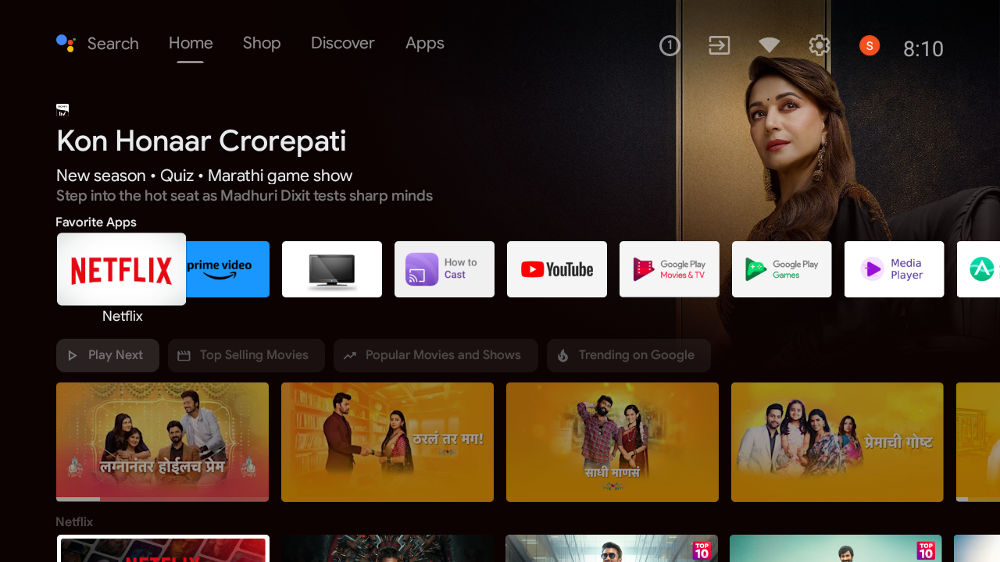
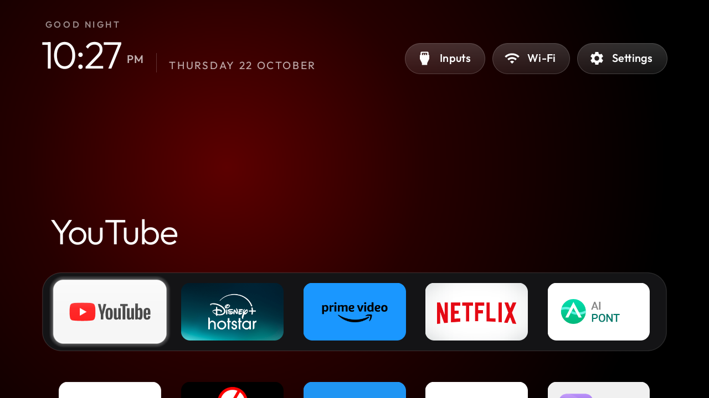
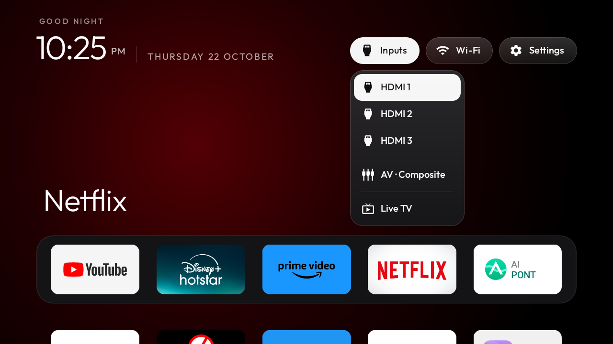

# Realme Smart TV Clean Setup & Apple TV 4K Style Launcher

[](https://android.com)
[](launcher-bin/app-release.apk)
[](README.md)
[](README.md)
[](README.md)
[](https://adguard-dns.io)

A lightweight, non-destructive debloat toolkit and native Apple TV 4K-style home screen configuration tailored for **Realme Smart TV** (Android 11, API 30 / Changhong `ikebukuro` board).

---

## 📌 Project Overview

Budget smart TVs often struggle with sluggish navigation, intrusive sponsored banners, and background analytics that consume up to 80% of their 1 GB RAM. 

This project completely revamps the user experience by:
1. **Eliminating Bloatware**: Suspending manufacturer telemetry (Anoki ACR), auto-installers, and redundant screen-sharing services via pure user-space ADB without risking a bootloop.
2. **Apple TV 4K Home Screen**: Replacing the cluttered stock launcher with a sub-500 KB native Android TV launcher that operates at fluid 60 FPS with real-time ambient backlighting.
3. **Hardware Integration**: Preserving physical TV hardware functions (HDMI 1/2/3, AV, and Live TV) via a frosted glass inputs dropdown backed by the Android TV Input Framework.
4. **Ad-Free Browsing**: Activating AdGuard Private DNS directly on the device for network-wide telemetry and tracker blocking.

---

## 📸 Visual Transformation

### Before: Stock Cluttered Android TV Home

*Cluttered with sponsored ads, content recommendation carousels, and manufacturer bloat.*

---

### After: Apple TV 4K Style Clean Home

*Pitch-black OLED background, dynamic ambient backlighting matching active app, Outfit typography, and frosted glass pills.*

---

### Inputs Dropdown (Compact Glass)

*Quick switching between HDMI 1, HDMI 2, HDMI 3, AV, and Live TV via the TV input framework.*

---

## 📺 Highlights & Features

* **Apple TV 4K Experience**: Pitch-black OLED theme, dynamic ambient glow matching the active app's banner, frosted glass pill buttons for Inputs, Wi-Fi, and Settings.
* **Deterministic Navigation**: Fast D-pad navigation, smooth grid expansion, compact Inputs dropdown covering all HDMI ports, AV, and Live TV.
* **Full Privacy & Debloat**: Automatic Content Recognition (ACR) and telemetry suspended (`pm suspend --user 0`) — zero system package deletions, 100% reversible.
* **AdGuard Private DNS**: Built-in DNS-level ad and tracking blocking (`dns.adguard-dns.com`).
* **Ultra Lightweight**: Launcher binary is under **500 KB** and uses ~25 MB RAM (compared to ~120 MB for the stock launcher).

---

## 🚀 Quick Start

### 1. Connect to TV over ADB
On the TV, enable Developer Options (**Settings → Device Preferences → About → Tap "Build" 7 times**), then turn on **USB debugging**.

Connect via your computer:
```bash
adb connect <tv-ip>:5555
```

### 2. Install the Launcher
Run the installation script:
```bash
chmod +x build-and-install.sh
./build-and-install.sh <tv-ip>
```

### 3. Reverting / Restoring
To restore all suspended apps and switch back to the original stock launcher:
```bash
chmod +x restore.sh
./restore.sh <tv-ip>
```

---

## 📋 Debloated Packages

All packages are **suspended** rather than permanently deleted:

| Category | Package | Purpose |
|---|---|---|
| **Surveillance** | `tv.anoki.acr.controller` | Anoki ACR — Automatic Content Recognition tracking |
| **Vendor Bloat** | `com.homwee.aipont` | AI PONT vendor portal & recommendation rows |
| **Vendor Bloat** | `com.cltv.fast` | FAST TV ad-supported channels |
| **Vendor Bloat** | `com.homwee.store` | Changhong proprietary store |
| **Vendor Bloat** | `android.autoinstalls.config.homwee` | Silent partner app downloader |
| **Vendor Bloat** | `com.homwee.help` | Help app |
| **Vendor Bloat** | `com.mstar.android.tv.disclaimercustomization` | Vendor Disclaimer |
| **Vendor Bloat** | `com.mediatek.testpq` | Factory picture test mode |
| **Screen Share** | `com.google.android.apps.mediashell` | Built-in Chromecast |
| **Screen Share** | `com.google.android.apps.nbu.smartconnect.tv` | Smart Connect setup |
| **Screen Share** | `com.homwee.multiscreenshare` | Miracast duplicate |
| **Screen Share** | `com.homwee.mmp.screenshare` | AirPlay clone |
| **Screen Share** | `com.homwee.howtocast` | "How to Cast" tutorial |
| **Screen Share** | `com.homwee.synckey` | Sync key service |
| **Screen Share** | `com.ionitech.airscreen` | AirScreen receiver |
| **Voice / Screen** | `com.google.android.katniss` | Google Assistant for TV |
| **Voice / Screen** | `com.google.android.backdrop` | Ambient backdrop screensaver |
| **Streaming Apps** | `com.jio.media.stb.ondemand` | JioCinema |
| **Streaming Apps** | `com.sonyliv` | SonyLIV |
| **Stock Launcher** | `com.google.android.tvlauncher` | Stock Android TV launcher |

To re-enable any individual package:
```bash
adb shell pm unsuspend --user 0 <package-name>
```

---

## 🎨 Customization

### Dock Order & Slots
By default, the bottom dock holds **5 slots**:
1. YouTube (`com.google.android.youtube.tv`)
2. Disney+ Hotstar (`in.startv.hotstar`)
3. Prime Video (`com.amazon.amazonvideo.livingroom`)
4. Netflix (`com.netflix.ninja`)
5. Settings / Next App

* **To reorder directly on TV**: Long-press **OK / Center** on any tile to open the action menu, select **Move**, and place it with the D-pad.
* **To reorder in code**: Edit `config/config.xml` under `<string-array name="dock_apps">`.

### Custom Wallpaper
To set a custom background image:
```bash
adb push my_wallpaper.jpg /sdcard/tvhome/wallpaper.jpg
```

---

## 🔒 Security: Closing ADB After Setup

When setup is finished, close debugging to secure your TV:
1. On the TV: **Settings → Device Preferences → Developer options**
2. Turn **USB debugging** **OFF**.
3. Select **Revoke USB debugging authorizations**.
4. Verify port 5555 is closed:
   ```bash
   python3 tools/adb-closed.py <tv-ip>
   ```

---

## 📜 Credits & License
Built with the [CleanYourTV](https://github.com/Gathin23/cleanyourtv) reference launcher framework (`com.gathin.tvhome`).
